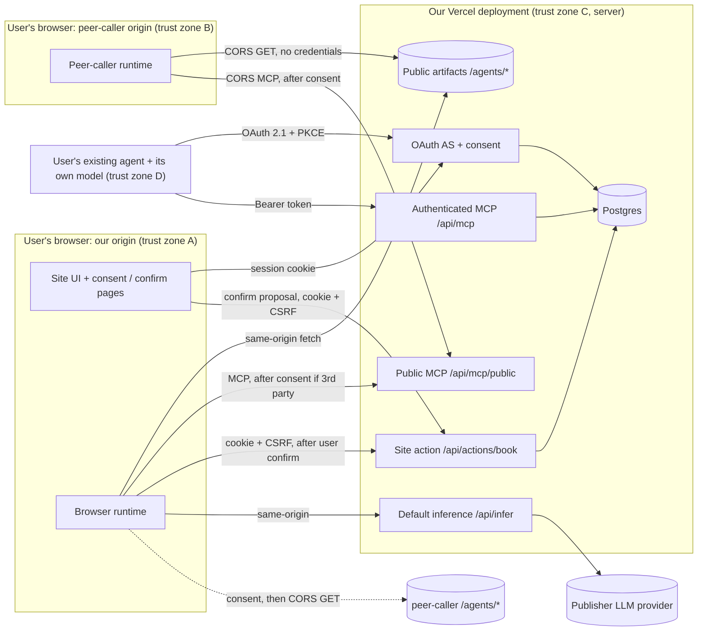
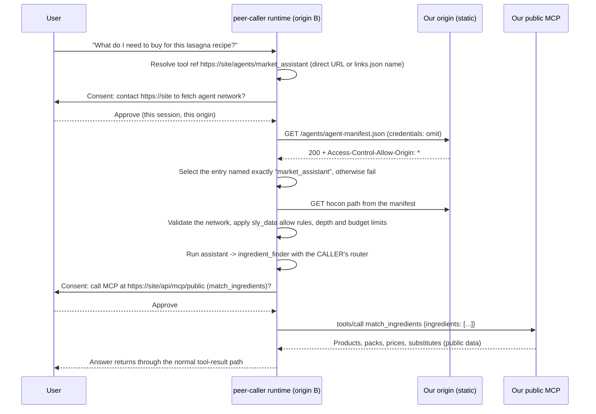
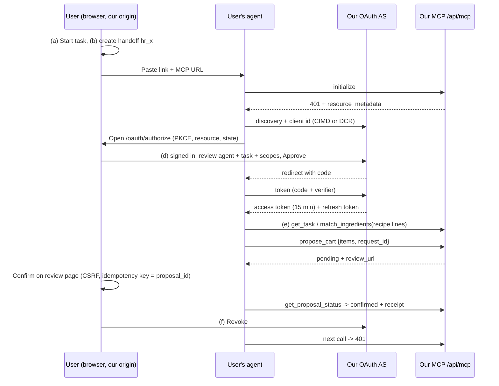

# Project Plan: Greenleaf Market, recipe to cart (working name)

An open agentic test website, hosted on Vercel: a fictional supermarket. A person has a recipe, and an AI agent goes into the store and gets every ingredient into their cart. That agent is either the store's own assistant or the agent the person already uses, with scoped, revocable access. The person confirms before anything is added.

> **Scenario change (`docs/adr/0004`):** the first draft of this plan used a volunteer-shift booking site. The architecture, spec mapping and security design are unchanged. The task is now "recipe → ingredients → cart", the read capability is ingredient matching, and the confirmed write is adding to the cart.

**Sources and verification status**

| Source | Status |
| --- | --- |
| [Worldwide Agentic Web MVP spec, Profile 0.3](https://github.com/cognizant-ai-labs/agentic-web/blob/main/docs/worldwide_agentic_web_mvp_spec.md) | Read in full while writing this plan. Section numbers below (for example "§3.2") refer to it. Recheck it before M1 and before submission, because it is a draft. |
| [Devpost challenge page](https://cognizant-agenticweb.devpost.com/) | **Not verified.** My fetch returned HTTP 403. The submission items in §10 are the ones the prompt lists. Confirm the deadline, video length, license rules and judging criteria by hand. |
| [Inspiration video](https://youtu.be/0avLDin5ZYY?si=i7VRyFmR2mjxf73b) | **Not reviewed.** I could not watch it. Nothing in this plan claims anything about its content. Assumption: it shows a user handing a website task to their own agent. |
| [MCP Authorization spec 2025-11-25](https://modelcontextprotocol.io/specification/2025-11-25/basic/authorization) | Linked from spec §7. Used for the authenticated MCP design. Recheck which features are current before M4. |
| [nsDeploy reference runtime](https://github.com/cognizant-ai-lab/nsdeploy) | Named in spec §3 and §8. Check its license and manifest schema in M0. |

---

## Recommended MVP (read this first)

One task, one public agent network, one read-only grounded capability, one user-confirmed write, and one authorization-link handoff.

- **Task:** The user has a recipe (pasted text or a dish name). An AI agent matches every ingredient to a product at a fictional supermarket ("Greenleaf Market") with pack counts, prices and substitutes, and puts them in the user's cart after the user confirms. The catalog is synthetic and public. The user's own data is their shopping task and cart. Checkout is out of scope.
- **Spec path (mandatory):** The site publishes `agent-manifest.json`, a resolved `market_assistant.network.json` (two agents: `assistant` → `ingredient_finder`), and `links.json` under `/agents/`, all with CORS enabled. A browser JavaScript runtime on the site runs the network using a publisher-funded default router, so visitors never configure an LLM. The grounded capability is a public, read-only MCP server with `match_ingredients` and `search_products`. The write, `add_to_cart`, is a registered local site action, and the runtime asks the user to confirm it.
- **Interop proof:** A second Vercel project on a separate origin (`peer-caller`, a recipe website) loads `market_assistant` by URL after the user approves contacting that origin. It runs the network in the caller's browser with the caller's router, so "what do I need to buy for this recipe?" is answered from the store's catalog. It also publishes a small network of its own (`recipe_helper`), which the store loads by its name in `links.json`.
- **Extension (product-specific, outside the spec):** "Hand off to my agent." The site creates a short-lived link. That link only points to the task; it is not a credential. The user's existing MCP-capable agent connects to an authenticated MCP endpoint and goes through OAuth 2.1 with PKCE. The user approves the scopes on the site, and the approval is bound to that task and that agent. The agent can read the shopping task, match its recipe against the catalog and propose a cart. Only the user, clicking on the store's site, can confirm it. The user can see the grant, its audit log and a Revoke button.
- **Not in the MVP:** a BYOK screen, site-owned AI in the handoff flow, multiple task types, a central registry, coded-tool bundles, or cross-site action transport.

---

## 1. Executive summary

| Item | Content |
| --- | --- |
| Working name | Greenleaf Market, recipe to cart (fictional supermarket) |
| Target user | Someone who already uses an AI agent with MCP support (for example Claude, ChatGPT connectors, VS Code, Cursor or Kiro; check each client's remote-MCP and OAuth support in M0) and wants that agent to do their grocery shopping for a recipe. |
| Problem | Websites either ignore the user's agent, or demand a password, an API key or broad access before the agent can help. Agents that scrape pages act without scoped consent and without a record. |
| Product promise | Bring a recipe. The store's assistant, or your own agent, finds every ingredient, flags substitutes and missing items, and proposes a cart. You approve exactly what an outside agent may see and propose, confirm the cart yourself, and can revoke access at any time. The site never asks for an LLM key. |
| Why it matters for the open agentic web | It shows both halves of the problem on ordinary HTTPS hosting. The first half is the spec's portable, public, browser-run agent network, which any conforming site can load. The second is a candid design for the part the spec leaves out: authenticated actions on the user's behalf by an agent the site did not choose (spec §1.1, §3.2 "Interactive MCP authentication", §7 "Authenticated MCP and hosted bridges"). |

## 2. Product boundaries

### 2.1 MVP user journeys

| ID | Journey | Path |
| --- | --- | --- |
| J1 | A shopper pastes a recipe (or names a dish) into the store's assistant. They get every ingredient as a product with pack count and price, substitutes for out-of-stock items, a list of items the store does not sell, and an estimated total. The data comes from the `match_ingredients` MCP tool. | Spec (local run, default router) |
| J2 | The assistant proposes `add_to_cart`. The runtime shows the destination, the action and the exact items. The shopper confirms, the cart fills, and a receipt is shown. | Spec (local site action) |
| J3 | A user on `peer-caller` (a recipe site) asks its agent what to buy for a recipe. They approve contact with the store's origin, the store's network loads and runs in their browser, and a shopping list with store products comes back. | Spec (peer loading) |
| J4 | The shopper clicks "Shop with my own agent" on the store (optionally noting servings, dietary needs and budget), copies the link and gives it to their agent together with the recipe. | Extension |
| J5 | The agent connects. The user signs in or is already signed in, reviews the agent's identity and the requested scopes, unticks anything unwanted and approves. | Extension |
| J6 | The agent reads the task, matches its recipe against the catalog and proposes a cart. The user reviews the items on the store's site and confirms, and the agent sees the result. | Extension |
| J7 | The user opens "Connected agents", reviews the audit log and revokes access. The agent's next call fails with 401. | Extension |

### 2.2 Non-goals

- A generic platform with many tasks or capability types. A real supermarket integration, real inventory or real personal data.
- Checkout, payment, delivery slots or orders. These are irreversible and handle payment data, so they come after the MVP.
- An LLM or model setup screen in the core flow. BYOK is optional in spec §4 and deferred here.
- Cross-site action transport (spec §3.2 marks it as an extension), A2A Agent Cards, durable or background agent runs.
- Agents writing directly with no human confirmation, even with a write scope.
- A central agent registry or discovery service.
- Payments, multi-tenant organizations or admin tooling beyond seed scripts.

### 2.3 Assumptions to validate

| ID | Assumption | How to validate | When |
| --- | --- | --- | --- |
| A1 | At least two popular agents can connect to a remote MCP server that uses OAuth (authorization code with PKCE) and can request custom scopes. | Connect each candidate client to a stub server. | M0 |
| A2 | The nsDeploy runtime can be reused under a license compatible with our repository, or a minimal TypeScript runtime is feasible in about a week. | Read the LICENSE file; run its demo against our files. | M0 |
| A3 | Vercel Hobby or Pro limits on functions, Marketplace Postgres and bandwidth are enough for a demo. Hobby is for non-commercial use. | Read the current Vercel docs; load-test the default-inference route. | M0, M7 |
| A4 | Stateless Streamable HTTP MCP (JSON responses, no long-lived SSE) works on Vercel Functions with the clients from A1. | Spike in M0. | M0 |
| A5 | The video's concept matches the handoff flow. | The user confirms it. | M0 |
| A6 | Judges can try the demo without any account friction. This drives the guest-session default in D3. | Recheck the Devpost rules. | M0 |


## 3. Architecture

### 3.1 Components

| Component | Responsibility | Hosting |
| --- | --- | --- |
| **Published artifacts** | `/agents/agent-manifest.json`, `/agents/market_assistant.network.json` (resolved JSON, built from HOCON source), `/agents/links.json`. Public, contain no secrets, CORS `*`, sent without credentials. | Vercel static output |
| **Browser runtime** | Parses and validates networks, runs the agent loop, translates tools into function schemas, handles consent before contacting other origins, filters private context (`sly_data`), enforces execution limits, confirms site actions, reports unknown outcomes and keeps a trace. Default: vendor nsDeploy (D1). | Static JS module |
| **User-facing site** | Store front (search, categories, add to cart), cart page, assistant chat (runtime UI), confirmation dialogs, "Shop with my own agent", "Connected agents" (grants, audit log, revoke), cart-proposal review page. | Static pages + Vercel Functions (ADR 0003) |
| **Default inference endpoint** `/api/infer` | Same-origin, OpenAI-compatible forwarding endpoint that uses a publisher-owned key from an env var. Rate limited, with a capped token budget and a kill switch. It serves only the site's own runtime and is never used in the handoff path. | Vercel Function |
| **Public MCP** `/api/mcp/public` | Read-only tools `match_ingredients` and `search_products` over the public synthetic catalog. No auth. CORS `*` so peer callers' browsers can reach it. | Vercel Function |
| **Cart endpoints** `/api/cart/*` | `quote` validates ids, stock and quantities and returns server prices (built). The server-side cart write for confirmed agent proposals comes in M5: same-origin only, session cookie plus CSRF token, idempotency key. | Vercel Function |
| **Identity and session** | Guest account created when the task starts (HttpOnly, Secure, SameSite=Lax cookie). Optional upgrade to a passkey (WebAuthn). Re-authentication is required on the consent page if the session is more than 12 h old. | Vercel Function + DB |
| **Authorization service** (extension) | Narrow OAuth 2.1 authorization server: Protected Resource Metadata (RFC 9728), AS metadata (RFC 8414), Client ID Metadata Documents and Dynamic Client Registration (RFC 7591), authorization code with PKCE S256 only, resource indicators (RFC 8707), opaque tokens stored hashed, refresh-token rotation, revocation (RFC 7009). Consent UI is bound to a handoff. | Vercel Functions + DB |
| **Authenticated MCP bridge** `/api/mcp` (extension) | Tools for the user's agent: `get_task`, `match_ingredients`, `search_products`, `propose_cart`, `get_proposal_status`. Each call validates the token, grant, scope, task binding, expiry and revocation. | Vercel Function |
| **Database** | Postgres from the Vercel Marketplace (default: Neon), with a separate branch for previews. | External managed service |
| **peer-caller** (test fixture) | Independent origin: a small recipe website with its own runtime, default router and the `recipe_helper` network. Loads `market_assistant` by URL. | Second Vercel project |
| **Third-party agents** (optional integrations) | The user's MCP client, which supplies its own model. We integrate only through MCP and OAuth. | Not ours |

### 3.2 Component diagram



### 3.3 Trust boundaries

| Boundary | What crosses | Controls |
| --- | --- | --- |
| A ↔ B (two browser origins) | Only public artifacts and public MCP responses. Peer network instructions run in the caller's runtime as **untrusted input** to the caller's model. | Same-origin policy, CORS without credentials, runtime consent per origin, `sly_data` denied by default, execution limits, caller's router always wins |
| A → C | Cookie-authenticated business calls | SameSite cookies, CSRF token, server-side authorization, idempotency keys |
| D → C (user's agent to our server) | Bearer token bound to user + task + client + scopes + expiry | Token introspection in the DB on every call, audience check, scope and field filtering, proposal-only writes |
| User → C (consent and confirmation) | Human decisions | Rendered only on our origin, framing blocked (`frame-ancestors 'none'`), CSRF protected, decision recorded in the audit log |
| C → LLM provider | Prompts from our own runtime only | Key held server-side, never sent to the browser; per-session rate limits |

### 3.4 Two separate paths

| | Path 1: peer-network loading (spec MVP) | Path 2: authenticated website action (extension) |
| --- | --- | --- |
| What moves | Declarative network data. Execution happens in the **caller's** browser. | A remote call to **our** server, which owns the data and the action. |
| Who runs the model | The caller site's active router | The user's own agent |
| Authentication | None. Artifacts are public and fetched without credentials. | OAuth 2.1 access token bound to a grant |
| User consent | The runtime's per-origin contact consent (spec §3.2 step 4, §5) | Scope consent on our site, plus per-write confirmation on our site |
| Can it write user data? | Only through a local site action of the **caller's** origin. Our `add_to_cart` is never callable from a peer origin. | Only by creating a proposal that the user confirms |
| Spec status | Mandatory | Extension. The spec says MCP authentication and cross-site actions are outside the minimum (§1.1, §3.2 MVP boundary, §7). |

## 4. End-to-end flows

### 4.0 Standard peer-network loading (spec §3.2)



The peer cannot fill the store's cart: `add_to_cart` is a local-only action of the store's origin, so the recipe site gets a shopping list, not a cart change. A redirect to another origin counts as a new destination and needs its own consent (spec §5). The peer's manifest router metadata is ignored for inference (spec §4).

### 4.1 Extension flows (a)–(f)

**(a) User starts a task.** The user opens the store and clicks "Shop with my own agent". The server creates a guest account and session, and the user can note servings, dietary needs, a budget and free-text notes. The shopping task is stored as `status=draft` with `owner=user`. The recipe itself usually stays with the user's agent.

**(b) User shares or opens the link in their agent.** The user clicks "Shop with my own agent". The server creates a handoff record: a 128-bit random reference (`hr_…`), bound to the task and the owner, with a 15-minute TTL and a single claim. The UI shows:
- the link `https://site/h/hr_…`, and
- the MCP server URL `https://site/api/mcp`, with copy buttons and client-specific steps.

The link is **not a credential**. Fetching it returns a descriptor (HTML for people, JSON for `Accept: application/json`) that holds only the MCP URL, the reference, the scopes the agent should request, the expiry and instructions. It contains no task data. Anyone who has only the link gets nothing without the owner's signed-in approval.

**(c) Agent requests access.**
1. The agent calls `/api/mcp` and receives 401 with `WWW-Authenticate: Bearer resource_metadata=…, scope="task.read catalog.read cart.propose"`.
2. The agent discovers the authorization server and identifies itself. Preferred: a Client ID Metadata Document, an HTTPS URL that we fetch and check. Fallback: Dynamic Client Registration, shown to the user as "unverified".
3. The agent opens `/oauth/authorize` in the user's browser with PKCE S256, `resource=https://site/api/mcp`, an exact `redirect_uri` and `state`.

**(d) User approves the selected scopes.** The consent page requires our session cookie, and re-authentication if the session is old. It **refuses** if the user has no unclaimed, unexpired handoff. This blocks consent phishing that an attacker starts. The page shows:
- the agent's name and `client_id`, its verification status, and the redirect host;
- the task to bind (the pending handoff is preselected; with several, the user picks one);
- one checkbox per scope, plus a field-level choice for task fields (`preferences` always included, `notes` opt-in);
- the expiry (default 1 h, max 24 h).

On "Approve", the server takes these steps in one transaction:
1. Marks the handoff as claimed.
2. Creates a grant `{user, task, client_id, redirect_uri, scopes, fields, expires_at}`.
3. Issues a single-use authorization code (60 s) bound to the grant and the PKCE challenge.
4. Writes an audit event.

The agent exchanges the code for an opaque access token (15 min) and a rotating refresh token (capped at the grant's expiry). The token's audience is `/api/mcp`. Deny, or closing the page, writes an audit event and returns `access_denied`.

**(e) Agent reads or proposes a write.**
- *Read:* `get_task` returns only the approved fields. `match_ingredients` and `search_products` return public catalog data.
- *Propose:* `propose_cart {items: [{product_id, quantity}], request_id}` re-validates every id, quantity and stock level on the server. It then creates a proposal `{grant, action: add_to_cart, args, args_hash, request_id, status: pending, expires 30 min}` and returns `{proposal_id, review_url, status: "pending_user_confirmation"}`. The agent tells the user to open `review_url`. Optional, if the client supports it: MCP URL-mode elicitation to open the same page.
- The review page, on our origin and requiring the session, shows the destination (Greenleaf Market, `site` origin), the action, every item with pack count and server price, the total, which agent proposed it, and the time. The user can untick items. Confirm calls `/api/cart/confirm` with the CSRF token and `idempotency_key = proposal_id`. Unticking items creates a reviewed subset; the hash binds what was confirmed.
- Result states: `confirmed` with a receipt ID, `rejected`, `expired`, or `unknown` (see §7.4). The agent polls `get_proposal_status`. **The model cannot confirm. No tool exists for confirming.**

**(f) User revokes access.** "Connected agents" lists the grants with their agent, scopes, fields, expiry, last use and audit log. Revoke sets `grant.revoked_at` and deletes all tokens for that grant. Pending proposals are cancelled. Because tokens are looked up in the DB on every call, the next agent call returns 401 `invalid_token`. Revocation also works from the token side (RFC 7009) for agents that support it.




## 5. Specification compliance matrix

Type: **M** = mandatory for MVP conformance, **O** = optional in the spec, **X** = this product's extension. Status values are as of plan approval: Planned, Deferred or N/A.

| # | Requirement (spec ref) | Type | Planned implementation | Evidence | Status |
| --- | --- | --- | --- | --- | --- |
| 1 | Network follows the Neuro SAN HOCON data model; the published form is resolved and data-only, with no includes, env substitutions or local paths (§2, §2.2) | M | HOCON source in `agents/`; build step resolves it to JSON and injects the deployment origin into MCP URLs at build time; CI fails if `include`, `${` or file paths remain | CI log; the published JSON | Planned |
| 2 | Minimum network content: name, description, front agent, unique agents, instructions, tool lists, JSON Schema inputs (§2.1) | M | `assistant` (front) and `ingredient_finder`; input schema `{ingredients: string[]}`; structured MCP output | Schema validation test | Planned |
| 3 | `sly_data` denied by default across boundaries; only named fields pass (§2.1, §5) | M | Allow only `locale` downstream; `session_hint` never allowed. Check the exact HOCON `allow` syntax against the HOCON reference. | Peer trace shows `locale` present and `session_hint` absent | Planned |
| 4 | `agent-manifest.json` with networks (name, `front_man`, `hocon`), top-site router metadata and peer policy; public GET with CORS (§3.3) | M | `/agents/agent-manifest.json`. The schema follows nsDeploy's manifest format (confirm in M0). | `curl` smoke check; independent-origin fetch | Planned |
| 5 | Resolved network JSON at the manifest location; public GET; CORS when fetched cross-origin (§3.3) | M | `/agents/market_assistant.network.json` | Smoke check | Done locally |
| 6 | `links.json` publisher bindings; caller overrides stored separately (§3.3) | M | `{"version":1,"networks":{"market_assistant":{"recipes":"https://<peer-caller>/agents/recipe_helper"}}}`; runtime overrides kept in localStorage | Smoke check; override test | Planned |
| 7 | HTTPS in production (§3.3) | M | Vercel-managed TLS; runtime rejects `http:` peers except loopback | Test with an `http://` peer | Planned |
| 8 | Runtime usable from a normal page; executes the graph in JS (§3) | M | Vendored nsDeploy runtime, or a minimal TypeScript runtime (D1) | Demo | Planned |
| 9 | Parse and validate: reject malformed networks, duplicate or missing references and a bad front agent before any model call (§3.1) | M | Validator runs before the first `/api/infer` call | Negative fixtures; the network log shows zero inference calls | Planned |
| 10 | Agent loop: streaming, tool calls, delegation, error propagation, bounded history (§3.1) | M | Runtime | E2E test | Planned |
| 11 | MCP as the baseline grounded capability; approval before discovering or calling a third-party MCP service (§3.1) | M | `/api/mcp/public` `match_ingredients`, `search_products`. Consent prompt when the runtime origin differs from the MCP origin. | Demo J1, J3 | Planned |
| 12 | Local site actions with name, purpose, schema, effect and handler; validate arguments; show destination and arguments before a write (§3.1) | M | `add_to_cart` (effect: write, local-only) registered on our origin only | Screenshot of the confirmation dialog | Planned |
| 13 | Accurate outcomes; a write timeout means unknown outcome; no automatic repeat (§3.1, §5) | M | Runtime "unknown" state; server reconciliation by idempotency key | Fault-injection test | Planned |
| 14 | Bounded execution: depth, invocations, remote calls, concurrency, time (§3.1) | M | Defaults of depth 4, 30 invocations, 10 remote calls, 2 concurrent and 90 s, each configurable per network up to the runtime maximum | Over-budget and cycle tests | Planned |
| 15 | Peer reference by URL; manifest at the site base; exact name match or fail (§3.2) | M | `https://site/agents/market_assistant` resolves with base `/agents/` | Wrong-name test fails visibly | Planned |
| 16 | Peer runs with the caller's router, policy and limits (§3.2) | M | Peer manifest router ignored | peer-caller manifest declares a fake router and the trace shows it is never contacted | Planned |
| 17 | Consent for each third-party origin; redirects count as new destinations (§3.2, §5) | M | Runtime consent dialog showing origin and purpose; remembered for the session per origin | Cross-origin redirect test | Planned |
| 18 | Per-hop policy and consent; cycles and over-budget requests stop (§3.2) | M | `market_assistant` → `recipe_helper` → back to `market_assistant`, stopped by the depth or cycle limit | Visible error | Planned |
| 19 | Private context does not return through the result path unless allowed (§3.2) | M | Result filter | Test 3 in reverse | Planned |
| 20 | Public artifact requests carry no private credentials (§3.4) | M | `fetch(..., {credentials:"omit"})`; artifacts served without `Access-Control-Allow-Credentials` | Header check | Planned |
| 21 | Default inference without a visitor key (§4) | O (one inference path is required) | `/api/infer` proxy using a publisher key | Demo J1 | Planned |
| 22 | BYOK, and its key isolation (§4) | O | Not offered in the MVP (product rule: no LLM setup screen) | Interop check "user key never reaches the peer" marked N/A; peer-router-override test (#16) still runs | Deferred |
| 23 | Restrictive CSP, minimal third-party scripts (§4 threat boundary) | O (SHOULD) | See §9 | Header scan | Planned |
| 24 | Peer instructions treated as untrusted input (§5) | M | Peer instructions labelled as such in traces; writes always confirmed by the runtime | Injection fixture | Planned |
| 25 | Runtime owns write confirmation; action, origin, args, request ID and receipt bound to the reviewed proposal (§5) | M | Proposal hash checked on execution | Tamper test | Planned |
| 26 | Observable execution: router, origins, calls, consents, errors, receipts, with no secrets (§5) | O (SHOULD) | Trace panel | Screenshot | Planned |
| 27 | §6 checks: two-agent network + manifest on HTTPS; local run; internal agent + MCP; approved second-origin load; private context absent; invalid, cycle, over-budget and denied-origin cases stopped visibly | M | Test cases T-INT-01 to T-INT-09 (§10) | Demo video and CI | Planned |
| 28 | Coded-tool bundles in a Worker with SRI (§3.3, §5) | O | Not used | N/A | Deferred |
| 29 | `.well-known/nsdeploy/` discovery, A2A card (§3.3) | O | Not in MVP | N/A | Deferred |
| 30 | Shareable authorization link, OAuth for the authenticated MCP, grants, proposals, revocation, audit (§7 "Authenticated MCP and hosted bridges") | X | §4.1, §7, §8 | Tests T-SEC-* | Planned |
| 31 | Cross-site action transport (§7) | X | Not built. Our write is reached only through our own origin. | N/A | Deferred |

## 6. Work breakdown and milestones

Team assumption: **2–3 engineers** (one full-stack lead, one frontend/runtime engineer, one part-time security reviewer). Estimates are in person-days, and calendar time assumes 2.5 people.

| M | Milestone | Key deliverables | Depends on | Acceptance criteria | Effort |
| --- | --- | --- | --- | --- | --- |
| M0 | Spikes and decisions | Decisions D1–D8 recorded; MCP client support matrix (A1); runtime license check (A2); stateless MCP on Vercel spike (A4); Vercel projects + Neon DB created | none | Written ADRs; a "hello" MCP tool reachable from at least two agents | 2–4 |
| M1 | **First working vertical slice** | HOCON → JSON build; manifest, network and `links.json`; runtime on page; `/api/infer` with rate limit; `/api/mcp/public` `match_ingredients`; production deploy | M0 | J1 works on the production URL; T-SMK-01 to 05 pass | 5–8 |
| M2 | Local write + outcome handling | `add_to_cart` site action, confirmation dialog, server-side price/stock validation, idempotent cart write, unknown-outcome state, receipt | M1 | J2 works; T-FN-04 and T-NEG-05 pass | 3–5 |
| M3 | **Cross-origin interoperability** | `peer-caller` recipe site on a separate origin; `recipe_helper` network; consent UI; `sly_data` rules; limits; negative fixtures | M1 | J3 works both ways; T-INT-01 to 09 pass from the independent origin | 5–8 |
| M4 | Handoff extension: auth + read | Guest sessions + optional passkey; handoff refs; OAuth AS (metadata, CIMD/DCR, authorize, token, refresh, revoke); consent UI; authenticated `/api/mcp` with `get_task` and `match_ingredients`; audit events | M2 | J4 and J5 work with two real agents; T-SEC-01 to 08 pass | 7–11 |
| M5 | Proposal write + revocation | Server-side cart; `propose_cart`, review page, `get_proposal_status`, "Connected agents" page, revoke, audit view | M4 | J6 and J7 work; revocation takes effect on the next call | 4–6 |
| M6 | **Authorization hardening** | CSP/HSTS/framing headers; CSRF; rate limits per IP, client and grant; log redaction; refresh reuse detection; injection fixtures; threat-model review | M5 | All of T-SEC-* and T-NEG-* green; an external reviewer signs off on §9 | 3–6 |
| M7 | **Deployment and demo preparation** | Production env vars; preview DB branch; smoke-check workflow on every deploy; screenshots; 2–3 min video; README; LICENSE; submission | M6 | Definition of done (§12) met; submission checklist rechecked against Devpost | 3–5 |
| | **Total** | | | | **32–53 person-days, about 3–5 calendar weeks** |

The work splits into two parallel tracks after M1: M2 and M4 (backend) alongside M3 (runtime and interop).


## 7. API and MCP design outline (planning level)

### 7.1 Public endpoints (no auth, CORS `*`, no credentials)

| Endpoint | Purpose |
| --- | --- |
| `GET /agents/agent-manifest.json` | Manifest |
| `GET /agents/market_assistant.network.json` | Resolved network |
| `GET /agents/links.json` | Peer link map |
| `POST /api/mcp/public` | MCP (Streamable HTTP, stateless, JSON responses). Tools `match_ingredients`, `search_products`. |
| `GET /h/{ref}` | Handoff descriptor (HTML or JSON). Returns no task data. Returns 404 whether the reference is unknown or expired, so references can't be probed. |
| `GET /.well-known/oauth-protected-resource`, `GET /.well-known/oauth-authorization-server` | OAuth discovery |

Manifest as built (nsDeploy schema, abridged; see `apps/site/public/agents/agent-manifest.json`):

```json
{
  "brand": "Greenleaf Market shopping assistant",
  "networks": [
    { "name": "market_assistant", "front_man": "assistant", "hocon": "./market_assistant.network.json",
      "description": "Shopping assistant for Greenleaf Market..." }
  ],
  "llm_router": { "base_url": "https://<site>/api/infer/v1", "site_funded": true, "byok_router": "", "mock": false },
  "peer_policy": { "mode": "open", "deny_origins": [] },
  "mcp": [{ "url": "https://<site>/api/mcp/public", "tools": ["match_ingredients", "search_products"], "auth": "none", "effect": "read" }],
  "actions": { "version": 1, "module": "./actions.js", "bridge": "./action-bridge.html" }
}
```

### 7.2 Tools

| Tool | Where | Scope | Input (JSON Schema summary) | Output | Authorization checks |
| --- | --- | --- | --- | --- | --- |
| `match_ingredients` | public MCP, auth MCP | none / `catalog.read` | `{ingredients: string[1..40]}` (recipe lines, e.g. "400 g spaghetti") | `{items:[{input, parsed, status: matched\|substituted\|out_of_stock\|not_found, product, packs, line_total, alternatives, note}], summary}` | Public, read-only. Lines capped at 40. |
| `search_products` | public MCP, auth MCP | none / `catalog.read` | `{query, category?, limit? ≤ 20}` | `{products:[{id, name, size, price, aisle, in_stock}]}` | Public, read-only |
| `add_to_cart` | local site action (runtime) | store origin only | `{items:[{product_id, quantity 1..20}] (1..40)}` | `{status: added\|already_added\|nothing_added, receipt_id, added, rejected, cart}` | Runtime validation + confirmation; server re-prices and checks ids and stock (`/api/cart/quote`); idempotent per request ID |
| `get_task` | auth MCP | `task.read` | `{task_ref?: string}` (optional; must match the grant's task if given) | `{task_id, status, preferences, notes?}`; fields filtered by the grant | Token valid, grant active, scope, field filter |
| `propose_cart` | auth MCP | `cart.propose` | `{items:[{product_id, quantity}], request_id: uuid}` | `{proposal_id, status:"pending_user_confirmation", review_url, expires_at}` | Scope; the same `request_id` returns the same proposal; at most 3 open proposals per grant |
| `get_proposal_status` | auth MCP | `cart.propose` | `{proposal_id}` | `{status: pending\|confirmed\|rejected\|expired\|unknown, receipt_id?}` | The proposal belongs to this grant |

There is no agent-callable confirm, checkout or payment tool in the MVP.

### 7.3 Authorization check on every authenticated MCP call (fail closed)

1. Bearer token present → look up its SHA-256 hash → token not expired.
2. Token audience equals `https://<site>/api/mcp`. No token passthrough to other services.
3. Grant active: not revoked, not past `expires_at`, user not deleted.
4. Tool's scope is in the grant; requested fields are in `grant.fields`.
5. Resource belongs to `grant.task_id`.
6. Rate limit per grant and per client.
7. Write an audit event (`tool`, `grant_id`, `client_id`, `result`, `request_id`, with no argument values beyond the IDs).

Any failure returns a typed MCP error (`unauthorized`, `forbidden_scope`, `grant_revoked`, `not_found`, `rate_limited`) and never returns partial data.

### 7.4 Idempotency and unknown outcomes

- Every write carries a client request ID (`request_id` or `idempotency_key`). A unique DB constraint on `(grant_id|session_id, key)` makes retries return the original result.
- The proposal is stored with `args_hash`. Confirmation executes only if the stored args still hash to the reviewed value. This binds the action, origin, arguments and request ID to what the user saw (spec §5).
- The server-side cart write (M5) runs in one DB transaction. If the confirm request times out in the browser, the UI shows **"Outcome unknown, checking…"**. It then queries `GET /api/cart/confirm/{idempotency_key}` and **never re-sends the POST**. The server state is authoritative: `committed`, `not_found` (the user may retry with the *same* key) or `in_progress`.
- MCP `get_proposal_status` reports `unknown` until the server has resolved the state.

### 7.5 Keeping credentials out of prompts and logs

- The agent's OAuth tokens live in the agent's MCP client transport layer and never appear in tool arguments. Tool schemas have no token or credential fields.
- The handoff reference is a pointer, not a credential, so seeing it in an agent's chat history grants nothing.
- The default-inference key exists only in a Vercel env var (Production and Preview kept separate, "Sensitive" type) and is never sent to the browser.
- Logging middleware drops the `Authorization` and `Cookie` headers and the `code`, `code_verifier`, `refresh_token` and `token` params, and hashes IPs. A CI test greps the logs from the E2E run for token prefixes.
- Tokens use prefixes (`swa_at_`, `swa_rt_`) so secret scanners can detect them.

## 8. Data model outline

| Entity | Key fields | Sensitive fields | Retention |
| --- | --- | --- | --- |
| `user` | id, kind (guest/passkey), created_at | passkey public key (low), email (none collected in MVP) | Guests purged after 30 days of inactivity |
| `session` | id_hash, user_id, created_at, last_auth_at, expires_at | session ID (stored hashed) | 7 days |
| `task` | id, owner_id, status, preferences JSON (servings, dietary needs, budget), notes, created_at | `preferences.dietary` (may reveal health or religion) and `notes` (free text) | 30 days after completion |
| `product` | id, name, category, aisle, size, price_cents, tags, stock | none (synthetic) | Seed data (`lib/catalog.js`) |
| `handoff` | ref_hash, task_id, owner_id, created_at, expires_at (15 min), claimed_at, claimed_by_grant | ref (hashed) | 7 days |
| `oauth_client` | client_id, kind (cimd/dcr), name, redirect_uris, metadata_url, verified, first_seen | none | Until unused for 90 days |
| `auth_code` | code_hash, grant_id, pkce_challenge, redirect_uri, expires_at (60 s), used_at | code (hashed) | 1 day |
| `grant` | id, user_id, task_id, client_id, redirect_uri, scopes[], fields[], created_at, expires_at, revoked_at, last_used_at | none (metadata) | 90 days after it ends, for audit |
| `token` | hash, grant_id, kind (access/refresh), family_id, expires_at, rotated_from, revoked_at | token (hashed) | Deleted at expiry or revocation |
| `proposal` | id, grant_id, action, args JSON, args_hash, request_id, status, expires_at, decided_at | args (low) | 90 days |
| `cart` / `cart_line` | cart: id, user_id, updated_at; line: cart_id, product_id, quantity, price_cents_at_add, source (shopper/site_action/proposal), idempotency_key | Shopping habits (low) | 30 days after last change. The M2 slice keeps the cart in browser localStorage. |
| `audit_event` | id, at, actor (user/agent:client_id/system), user_id, grant_id?, type, target, result, request_id, ip_hash | ip_hash | 90 days. Append-only (no UPDATE/DELETE privilege for the app role). |
| Agent/network identity | Not stored. A peer network is identified at runtime by `(origin, network name, manifest URL)` in session consent memory. | none | Session only |

## 9. Security, privacy and abuse review

| Threat | Mitigation (mechanism) | Test | Residual risk |
| --- | --- | --- | --- |
| **Link forwarding**: the handoff link leaks or is forwarded | The reference is not a credential. Consent requires the owner's session. The link expires in 15 min and can be claimed once. | T-SEC-01: a second browser opens the link and can't approve | The owner can still knowingly approve the wrong agent |
| **Replay** of a handoff ref, auth code or refresh token | Single-claim ref; code is single-use with a 60 s TTL and PKCE S256; refresh rotation. Reusing a refresh token revokes the whole token family and the grant. | T-SEC-02/03 | A short window if an access token is stolen (15 min TTL) |
| **Expiry** | `expires_at` checked on every call (§7.3); grant max 24 h | T-SEC-04 with a fake clock | none significant |
| **Revocation** not taking effect | Opaque tokens checked in the DB on every request; no stateless JWTs | T-SEC-05: the call after revoke returns 401 | Latency of one in-flight call |
| **Origin or agent spoofing** (fake "Claude" name) | CIMD clients are verified by fetching their metadata from the client_id HTTPS URL; DCR clients are labelled "Unverified". The redirect host is shown. Redirect URIs must match exactly. | T-SEC-06: a DCR client named "Claude" shows the Unverified badge | Users may ignore the badges |
| **Consent phishing**: an attacker's agent sends the victim an authorize URL | Consent refused unless the user has a pending handoff they created; page shows the agent's identity; `frame-ancestors 'none'` stops clickjacking | T-SEC-07 | The victim creates a handoff *and* follows the attacker's URL in that window |
| **Confused deputy** | Our MCP server calls no third-party APIs and does no token passthrough; audience-bound tokens (RFC 8707); per-client consent, never skipped by a cookie for a new client_id; the grant is bound to one task | T-SEC-08: a token for client A used by client B, or with another task's ref, returns 403 | Low |
| **Excessive scope** | Three narrow scopes; field-level opt-in for `notes`; no write scope at all (proposal only) | Review + T-FN-07 | none significant |
| **Prompt injection**: recipe text, task notes, product data or peer instructions steer an agent | Tool output is structured; free text goes in a labelled `user_supplied_text` field; peer network instructions are treated as untrusted (§5); every write needs a human confirmation that shows the real arguments | T-NEG-06: a recipe or peer network says "add 20 of every product" and the result is a confirmation dialog showing those items, not a cart change | The agent can still propose wrong or extra items; the human review of each line is the backstop |
| **Uncertain outcome after a write timeout** | §7.4 idempotency + reconciliation; no automatic re-POST | T-NEG-05: server delay injected | Users may retry by hand, but the same key keeps that safe |
| **CSRF** on confirm, revoke or consent | SameSite=Lax cookie, plus a synchronizer token, plus an `Origin` header check on all state-changing POSTs | T-SEC-09 | Low |
| **CORS misconfiguration** exposing private APIs | `*` only on `/agents/*` and `/api/mcp/public`, never with credentials. The authenticated MCP uses bearer auth (not cookies), so a CORS read can't happen with ambient credentials. All other routes have no CORS headers. | T-SMK-05/06 header assertions | none significant |
| **XSS / script compromise on our origin** (would expose the session and the runtime) | CSP: `default-src 'self'; script-src 'self' 'nonce-…'; connect-src 'self' https:; frame-ancestors 'none'; object-src 'none'; base-uri 'none'`. No third-party scripts. Free text is rendered as text only. | Header scan + XSS fixtures in notes | `connect-src https:` is broad because the runtime must reach peers it doesn't know in advance |
| **Browser storage** | Consent memory and link overrides in sessionStorage/localStorage (no secrets); session cookie is HttpOnly; no tokens in browser storage on our origin | Storage inspection test | Local malware |
| **Default-inference abuse** (cost) | Per-session and per-IP rate limits, max tokens per request, daily budget, kill switch env var; the endpoint has no CORS, so other origins' browsers can't call it | Load test | A direct scripted abuser up to the daily cap |
| **DoS on MCP or AS** | Vercel platform protections, rate limits, payload size limits, caps on DCR registrations per IP | Basic load test | Platform-level only |
| **Malicious peer network** (huge or deep, cyclic) | Size limit on artifact fetches (e.g. 512 KB), validation first, depth and invocation budgets | T-INT-06/07 | none significant |
| **Privacy** | No email or real PII; synthetic catalog; dietary preferences are opt-in fields; retention per §8; audit stores hashed IPs | Review | Notes text the user chooses to share with their agent |

**Where protections live**

| Layer | Protections |
| --- | --- |
| Browser runtime | Validation, consent before contacting other origins, redirect re-consent, `sly_data` filtering, execution limits, write confirmation for local actions, unknown-outcome state, `credentials:'omit'` for artifacts, trace |
| Website backend | Sessions, CSRF, OAuth AS, grant/scope/field checks, proposal-only writes, args-hash binding, idempotency, revocation, audit, rate limits, log redaction |
| Deferred | Signed manifests and pinning (§7 "Versioning integrity"), destination-scoped `sly_data` policies, cross-site action transport, BYOK and its isolation, DPoP or other sender-constrained tokens, passkey-only accounts, agent reputation |


## 10. Test and demonstration plan

### 10.1 Deployment smoke checks (run against every production and preview deploy, from GitHub Actions, which is a separate origin)

| ID | Check | Pass condition |
| --- | --- | --- |
| T-SMK-01 | `GET https://<site>/agents/agent-manifest.json` with `Origin: https://smoke.example` | 200, valid JSON matching the manifest schema, `Access-Control-Allow-Origin: *`, no `Allow-Credentials` |
| T-SMK-02 | GET the network JSON at the manifest's `hocon` path | 200, CORS, passes the network validator, contains no `include`/`${` |
| T-SMK-03 | `GET /agents/links.json` | 200, CORS, every target is HTTPS |
| T-SMK-04 | `http://` request | 308 to HTTPS; HSTS header present |
| T-SMK-05 | `OPTIONS /api/mcp/public` preflight | Allows POST and `content-type, mcp-protocol-version, mcp-session-id` |
| T-SMK-06 | `OPTIONS /api/actions/book` and `/api/infer` from another origin | No CORS allow headers |
| T-SMK-07 | MCP `tools/list` on `/api/mcp` without a token | 401 with `WWW-Authenticate` `resource_metadata` |

Preview deployments: Vercel Deployment Protection blocks fetches from other origins. Either run the smoke checks with the protection-bypass header (stored as a CI secret) or run interop only against production. The default is to do both: smoke checks on previews with the bypass, and full interop on production.

### 10.2 Functional

| ID | Case |
| --- | --- |
| T-FN-01 | J1: a recipe is answered from `match_ingredients` (the trace shows an MCP call), with substitutes and not-found items flagged |
| T-FN-02 | Internal delegation `assistant → ingredient_finder` is visible in the trace |
| T-FN-03 | Peer named link: `recipes` resolves through `links.json`; a local override in storage wins without changing the published file |
| T-FN-04 | J2: `add_to_cart` shows a confirmation with origin and items → receipt and cart page; declining changes nothing; invented product ids are rejected |
| T-FN-05 | J4–J6 with two real agents from A1 |
| T-FN-06 | J7: revoke → 401; the audit log lists every step |
| T-FN-07 | Unticking `notes` at consent → `get_task` omits notes |

### 10.3 Interoperability (from the `peer-caller` origin; aligns with spec §6)

| ID | Case |
| --- | --- |
| T-INT-01 | Load the exact `market_assistant` by URL after consent, run it with the caller's router (the trace shows the router origin = peer-caller) |
| T-INT-02 | Deny consent → visible "origin denied" error, zero requests to our origin (checked with a network log) |
| T-INT-03 | Wrong network name → fails with no fallback |
| T-INT-04 | Peer manifest's router metadata is ignored |
| T-INT-05 | `sly_data`: `locale` present at the peer, `session_hint` absent, in both directions |
| T-INT-06 | Invalid network (duplicate agent, missing front agent) → rejected before any model call |
| T-INT-07 | Cycle `market_assistant ↔ recipe_helper` → stopped by the limit, with a visible error |
| T-INT-08 | Over-budget request (invocation limit set to 2) → visible error |
| T-INT-09 | Cross-origin redirect on the manifest → new consent prompt |
| T-INT-10 | Optional: load our network from the nsDeploy reference runtime, or from another team's conforming site |

### 10.4 Negative and security

T-SEC-01 to 09 are listed in §9. Additionally:

| ID | Case |
| --- | --- |
| T-NEG-01 | Expired handoff → 404; claimed handoff → 404 |
| T-NEG-02 | Auth code reused → `invalid_grant`, and the grant is revoked |
| T-NEG-03 | `redirect_uri` mismatch → rejected before consent |
| T-NEG-04 | Missing or plain PKCE → rejected |
| T-NEG-05 | Write timeout → "unknown" shown, no second POST, reconciliation reports the true state |
| T-NEG-06 | Prompt-injection fixtures (notes, peer instructions) → no write without confirmation |
| T-NEG-07 | Tampered proposal args after review → confirmation refused (hash mismatch) |
| T-NEG-08 | Logs of the full E2E run contain no `swa_at_`/`swa_rt_`/cookie values |

Tools: Vitest (unit), Playwright with two origins (E2E/interop), MCP Inspector (manual OAuth checks), a `curl` script (smoke).

### 10.5 Short browser demo (2–3 min video; confirm the length limit on Devpost)

1. Open `https://<peer-caller>` (show the URL bar: different origin). Paste a recipe and ask what to buy, approve the consent for `<site>`, and show the DevTools network panel fetching `agent-manifest.json` and the network JSON with CORS headers. The shopping list comes from the store's MCP tool, using peer-caller's router.
2. Switch to `https://<site>`, paste the same recipe into the store's assistant, review the proposed items and confirm. Show the filled cart page. Then click "Shop with my own agent".
3. In a real agent (for example Claude or VS Code), paste the link and MCP URL, go through the consent page, untick `notes` and approve.
4. Give the agent a recipe. It matches the ingredients and proposes a cart. Open the review link, check the items and confirm. The agent reports the receipt.
5. Open "Connected agents", show the audit log and revoke. The agent's next request fails.

### 10.6 Deliverables

| Deliverable | Detail |
| --- | --- |
| Public website URL | `https://<project>.vercel.app` (or a custom domain) and `https://<peer-caller>.vercel.app` |
| Open-source repository | Public GitHub repo; Apache-2.0 recommended (check compatibility with any vendored runtime, D1) |
| Screenshots | Consent dialog (peer), MCP trace, ingredient table with substitutes, add-to-cart confirmation, cart page, OAuth consent page, Connected agents + audit, smoke-check CI run |
| Demo video | §10.5 |
| README | What's spec and what's extension, how to run locally, how to connect an agent, the compliance matrix |
| Submission form items | Recheck on the [Devpost page](https://cognizant-agenticweb.devpost.com/) (not verified, HTTP 403) |

## 11. Risks and decisions

### 11.1 Known facts (from the spec)

- Cross-site action transport and MCP authentication are outside the MVP minimum (§1.1, §3.2, §7). Our handoff is an extension.
- The peer runs in the caller's browser with the caller's router. A peer can't receive or replace the router credential (§3.2, §4).
- A conforming site needs one working inference path. A publisher default without BYOK conforms (§4 "Optional BYOK").
- Only public artifacts need cross-origin access. Action and auth endpoints keep their normal origin policy (§3.3).

### 11.2 Assumptions

A1–A6 in §2.3.

### 11.3 Decisions, with recommended defaults

| ID | Decision | Recommended default | Why | Decide by |
| --- | --- | --- | --- | --- |
| D1 | Runtime: vendor nsDeploy, or write a minimal TS runtime | **Decided:** vendor nsDeploy (Apache-2.0), pinned and patched. See `docs/adr/0001`. | It's the reference runtime, which makes conformance easiest to show | M0 ✔ |
| D2 | Framework | **Decided:** static output + Vercel Functions (Web signature) instead of Next.js. See `docs/adr/0003`. | nsDeploy already generates the agent UI; the APIs are small | M0 ✔ |
| D3 | User auth | Guest session at task start + optional passkey; a re-auth prompt on consent if the session is old | Judges can try it with no sign-up; passkeys avoid passwords and email | M0 |
| D4 | OAuth AS: build a narrow one, or use a hosted IdP (WorkOS AuthKit, Auth0, Stytch, Clerk) | Build a narrow AS on vetted libraries (`jose`, `oauth4webapi` for tests), with opaque tokens | Task-bound grants and custom consent are hard to do on hosted IdPs. Fallback: hosted IdP for client/token handling, with grant binding in our DB. | M0 |
| D5 | Client identity | Accept CIMD (verified) and DCR (unverified badge) | The MCP 2025-11-25 auth spec prefers CIMD, and many clients still use DCR | M0 (after A1) |
| D6 | Write confirmation channel for agents | Review page on our site; MCP URL-mode elicitation as progressive enhancement | Works with every client; the human confirms on our origin | M4 |
| D7 | Database | Neon Postgres via the Vercel Marketplace, with a branch per preview | Free tier, transactional, branching | M0 |
| D8 | Default inference provider and model | **Decided:** a server-chosen OpenAI-compatible model behind `/api/infer/v1`, with no BYOK. See `docs/adr/0002`. The daily cap comes with the shared store. | Needed for spec §6 local runs; it isn't part of the handoff flow | M1 ✔ |
| D9 | Deployment origin in artifacts | **Decided for now:** a build-time `--site-url` for the production origin, with artifacts committed. Previews use production artifacts (`docs/adr/0003`). | The spec forbids runtime substitutions in published artifacts | M1 ✔ |

### 11.4 Top risks

| Risk | Likelihood | Impact | Mitigation |
| --- | --- | --- | --- |
| Target agents' OAuth or custom-scope support differs from the MCP spec | Med | High | A1 spike; support a default scope set when the client sends none |
| Bugs in our own AS | Med | High | Narrow feature set, conformance checklist, T-SEC suite, external review in M6 |
| Spec draft changes before submission | Med | Med | Recheck at M1 and M7; matrix rows cite sections |
| Vercel Hobby limits (non-commercial terms, function duration, preview protection) | Low–Med | Med | Stateless MCP; Pro trial if needed; the bypass header for previews |
| Default-inference cost abuse | Med | Low | Caps and kill switch |

## 12. Repository structure and definition of done

Actual layout (ADR 0003: static output + Vercel Functions instead of Next.js):

```
greenleaf-market/
├─ agents/
│  ├─ market_assistant.hocon          # network source; __SITE_ORIGIN__ filled in at build time
│  └─ sites/market_assistant/         # agent page theme, store nav (site.js), add_to_cart (actions.js)
├─ apps/
│  ├─ site/                           # Vercel project 1 (Root Directory)
│  │  ├─ public/                      # store front, cart page, cart-store.js
│  │  │  └─ agents/                   # generated: manifest, network JSON, links.json, runtime (committed)
│  │  ├─ api/mcp/public.js            # public MCP: match_ingredients, search_products
│  │  ├─ api/infer/v1/chat/completions.js  # site-funded inference proxy
│  │  ├─ api/products.js, api/cart/quote.js
│  │  ├─ api/mcp.js, api/oauth/*, api/cart/confirm.js   # M4–M5 (extension)
│  │  ├─ lib/catalog.js, lib/http.js
│  │  └─ vercel.json                  # CORS for /agents/*, CSP, HSTS, function limits
│  └─ peer-caller/                    # M3: recipe site on a second origin, recipe_helper network
├─ packages/runtime/                  # vendored nsDeploy runtime + PATCHES.md
├─ vendor/nsdeploy/                   # pinned submodule, build time only
├─ scripts/                           # build-agents, dev-server, smoke
├─ tests/                             # catalog, HTTP, headless runtime end to end
├─ docs/adr/                          # 0001–0004
├─ .github/workflows/                 # ci.yml, smoke.yml
├─ LICENSE (Apache-2.0), NOTICE, README.md
```

**Definition of done**

- J1–J7 work on the production HTTPS URL.
- Every **M** row in §5 has evidence linked in `docs/compliance-matrix.md`.
- T-SMK, T-INT-01 to 09, T-SEC and T-NEG pass in CI against production from a separate origin.
- No secrets appear in published artifacts, the browser bundle or logs (automated checks).
- The handoff works with at least two real third-party agents.
- The public repo, license, README, screenshots and demo video are published, and the Devpost requirements have been rechecked.

---

## Progress and next five implementation tasks

**Done (local, 28 tests passing):**
- nsDeploy license and manifest check, with the runtime vendored and patched (ADR 0001).
- `market_assistant` network, published artifacts with CORS, and the site-funded model (ADR 0002).
- Public MCP `match_ingredients` / `search_products` over a 164-product catalog.
- `add_to_cart` site action with runtime confirmation, server re-pricing and replay protection.
- Store front and cart page.
- CI and smoke workflows.

**Next, in order:**
1. **Deploy to Vercel:**
   - Confirm the production domain and rebuild the artifacts for it.
   - Set `INFERENCE_API_KEY`.
   - Run `npm run smoke` from another origin.
   - Try J1 and J2 in a real browser with the real model.
2. **Agent-client spike (A1):** connect two real agents (for example Claude and VS Code) to a stub OAuth-protected MCP server on the deployment, and record which ones support OAuth and custom scopes.
3. **M3 `peer-caller` recipe site:**
   - A second Vercel project with a `recipe_helper` network.
   - Load `market_assistant` both ways through `links.json`.
   - Consent, `sly_data`, cycle, budget and denied-origin tests.
4. **Database and server-side cart:**
   - Neon via the Vercel Marketplace.
   - Guest sessions and a server-side cart, with the browser cart migrated to it.
   - A shared rate-limit store and a daily inference budget.
5. **M4 handoff:**
   - Handoff refs and the OAuth authorization server, with consent bound to the task.
   - Authenticated `/api/mcp` with `get_task` and `match_ingredients`.
   - Then M5: `propose_cart`, the review page and revocation.
