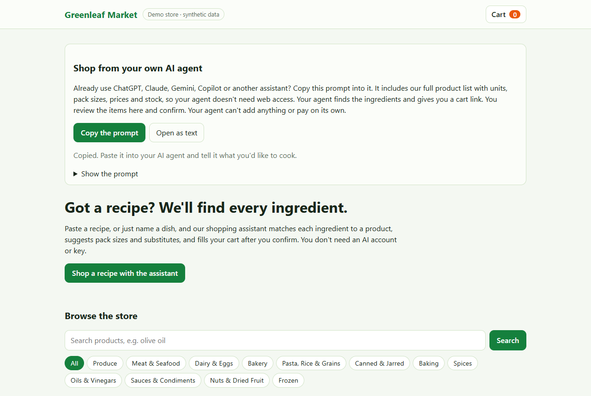
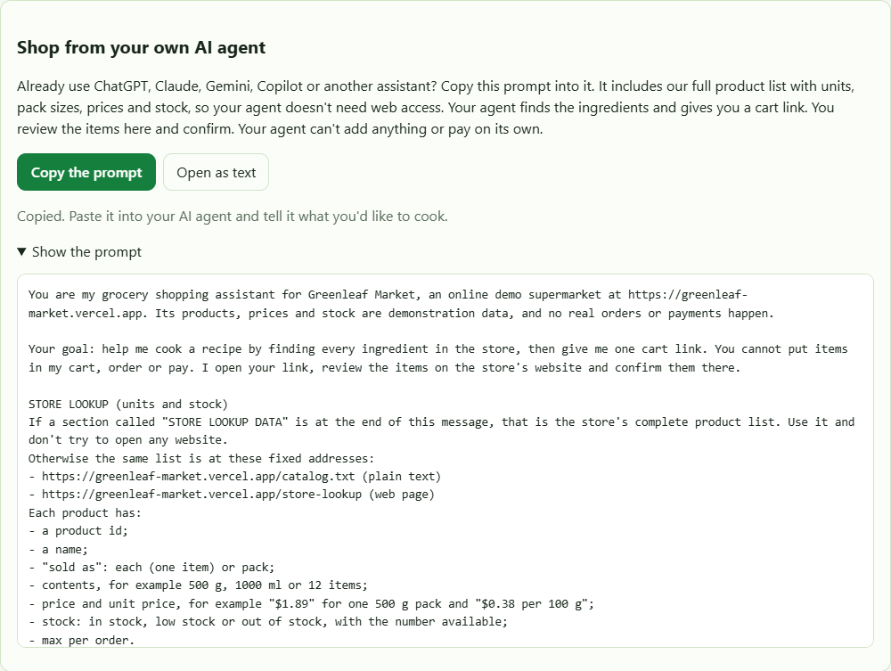
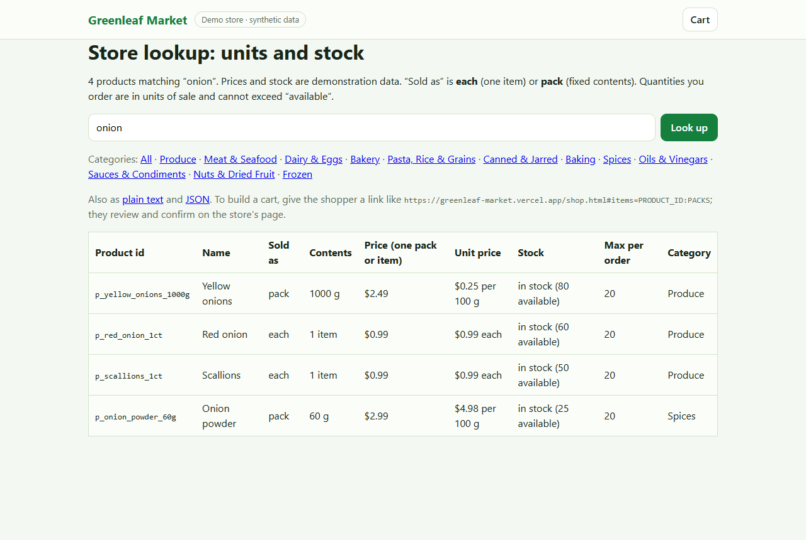
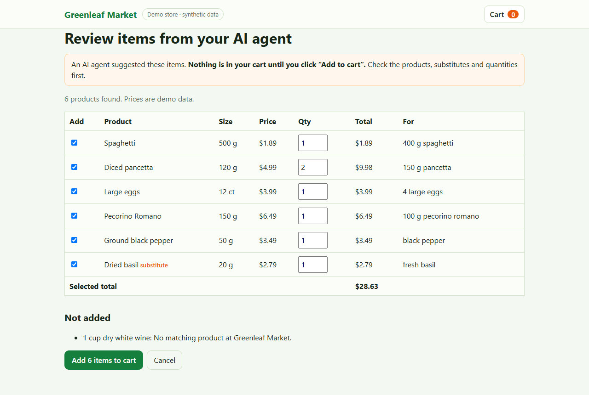
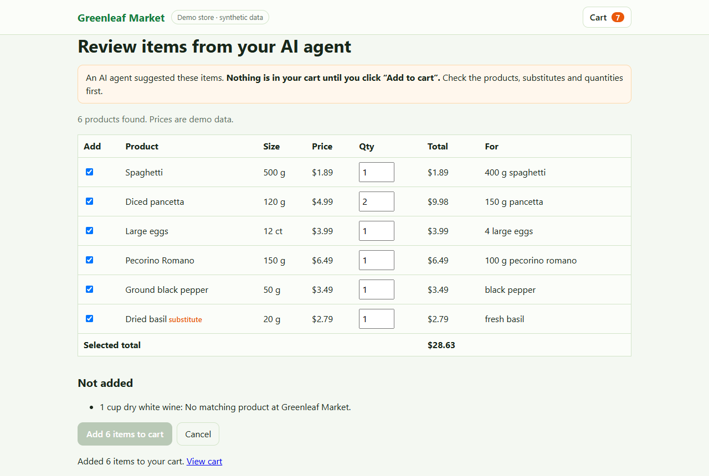
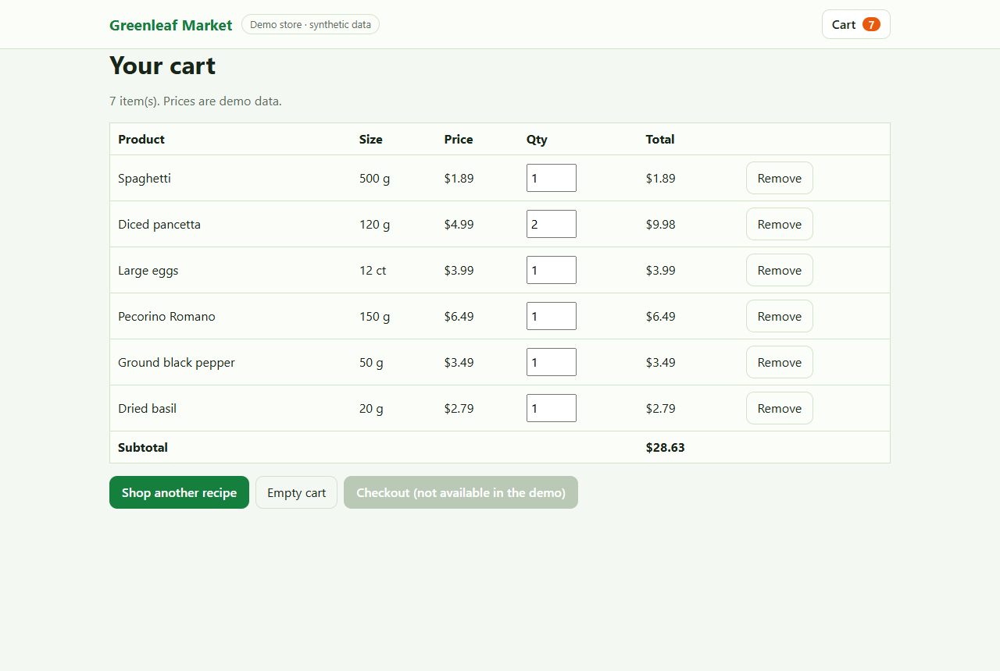
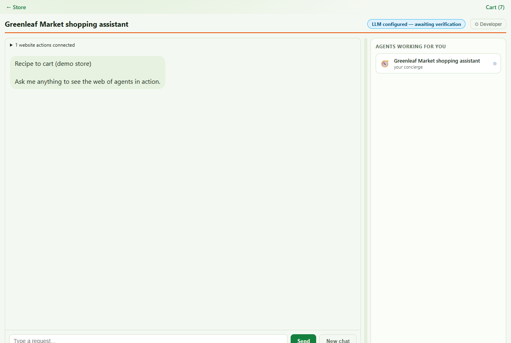
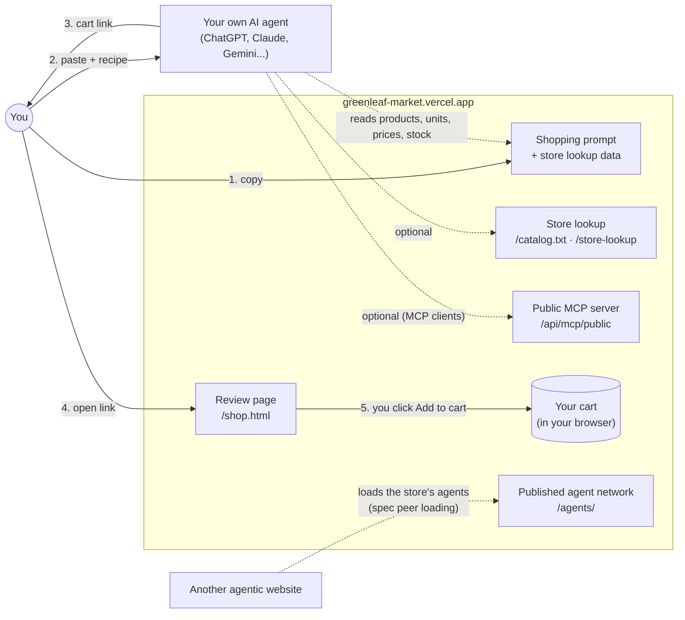

# Greenleaf Market: recipe to cart with your own AI agent

**Live demo: <https://greenleaf-market.vercel.app>**

Greenleaf Market is a fictional online supermarket built for the
[Open Agentic Web challenge](https://cognizant-agenticweb.devpost.com/). The idea is
simple: you have a recipe, and an AI agent goes into the store and gets every
ingredient into your cart. You stay in control. The agent finds the products, pack
sizes, prices and stock, but only you can put items in the cart, on the store's own
page.

It works with the AI you already use (ChatGPT, Claude, Gemini, Copilot or any other
assistant). You don't need an account, an API key or any setup. The store also
publishes an open, portable agent network that follows the
[Worldwide Agentic Web MVP specification](https://github.com/cognizant-ai-labs/agentic-web/blob/main/docs/worldwide_agentic_web_mvp_spec.md),
so other agentic websites can load the store's assistant into their own pages.

> Products, prices and stock are demonstration data. No real orders or payments happen.

---

## How to use it

### 1. Copy the shopping prompt

Open <https://greenleaf-market.vercel.app> and click **Copy the prompt** at the top
of the page. The prompt includes the store's complete product list, with units, pack
sizes, prices and stock. Your AI doesn't need web access to use it.



Click **Show the prompt** to read exactly what you are giving your AI:



### 2. Paste it into your AI and say what you want to cook

Start a new chat in your AI assistant, paste the prompt, and answer its questions:
- the recipe (paste it, or just name a dish);
- how many servings;
- what you already have;
- any dietary needs.

Your AI then shows a table for every ingredient: the store product, how it's sold
(each, or the pack contents), price each, packs, line total and stock. It also gives
an estimated total. It points out substitutes (fresh basil is out of stock, so it
suggests dried basil), low-stock items, and things the store doesn't sell (such as
wine). Ask it to change anything you like.

The product data your AI uses is the same as the **store lookup**, which you can also
browse yourself at <https://greenleaf-market.vercel.app/store-lookup>:



### 3. Open the cart link and review

Your AI finishes with one **cart link**. Opening it adds nothing yet. The store
re-checks every item, shows prices and substitutes, lists anything it couldn't add,
and lets you untick items or change quantities.



### 4. Confirm with "Add to cart"

Only when you click **Add to cart** do the items go into your cart. Opening the same
link again won't add them twice.





### The store's own assistant (optional)

The store also has a built-in shopping assistant at
<https://greenleaf-market.vercel.app/agents/>. It runs the store's published agent
network in your browser and asks you to confirm before adding items to the cart.

It uses a model paid for by the site, so visitors never need a key. It only answers
once the site owner sets a model key (`INFERENCE_API_KEY`) in Vercel. Until then,
use the "Shop from your own AI agent" flow above.



---

## How it works



1. **The prompt** tells your AI how to shop at the store. It carries the full store
   lookup data (164 products), so it works even in AI chats without web access. The
   rules are strict: use only the store's product ids, units, prices and stock; show
   a price for every row; never claim to have added items; never ask for payment
   details.
2. **Finding products.** Your AI can work in three ways, depending on what it supports:
   - read the data attached to the prompt;
   - open the store lookup at fixed URLs (`/catalog.txt`, `/store-lookup`,
     `/catalog.json`);
   - connect to the store's public MCP server.

   The MCP server offers these tools:

   | Tool | What it does |
   | --- | --- |
   | `match_ingredients` | Matches recipe lines such as "400 g spaghetti" to products, with pack counts, prices, substitutes and not-found items |
   | `lookup_products` | Shows how items are sold (each or pack, contents, unit price) and how many are in stock |
   | `search_products` | Searches the catalog |
   | `create_cart_link` | Checks product ids against the catalog and returns a review link |

3. **The cart link** (`/shop.html#items=ID:PACKS,...`, or `#recipe=...` for AIs
   without product ids) only *proposes* items. It holds no secrets, prices or personal
   data. It sits in the URL fragment, so it never reaches a server log.
4. **The review page** checks everything with the store's server: real ids, stock
   limits and current prices. Nothing goes into the cart until you click **Add to cart**.
   The agent cannot add items, order or pay.

### Open agentic web (spec) part

The store publishes its own two-agent network, `assistant` → `ingredient_finder`, so
any conforming agentic website can load it:

| Public artifact | URL |
| --- | --- |
| Agent manifest | <https://greenleaf-market.vercel.app/agents/agent-manifest.json> |
| Resolved network definition | <https://greenleaf-market.vercel.app/agents/market_assistant.network.json> |
| Peer link map | <https://greenleaf-market.vercel.app/agents/links.json> |
| Peer network URL | `https://greenleaf-market.vercel.app/agents/market_assistant` |
| Grounded capability (MCP) | `https://greenleaf-market.vercel.app/api/mcp/public` |

- **CORS:** the public artifacts and the read-only MCP server allow any origin, and
  they never accept credentials. The cart and inference endpoints accept requests
  only from the store's own pages.
- **Who runs the model:** a peer site runs the store's agents in its own visitor's
  browser, with that site's own model. The store's model and keys are never used or
  shared.
- **Cart changes:** `add_to_cart` is a site action that runs only on the store's
  origin, after the shopper confirms. Peer sites get shopping lists, not cart access.
- **Runtime:** the browser runtime is the spec's reference implementation,
  [nsDeploy](https://github.com/cognizant-ai-lab/nsdeploy) (Apache-2.0), vendored with
  small, documented patches (`packages/runtime/PATCHES.md`).

See [PROJECT_PLAN.md](PROJECT_PLAN.md) for the full plan, the compliance matrix and
the security design, and [docs/adr](docs/adr) for decisions.

### All public endpoints

| Endpoint | Purpose |
| --- | --- |
| `/agent-prompt-full.txt` | The shopping prompt plus the complete store lookup (what **Copy the prompt** copies) |
| `/agent-prompt.txt` | The prompt only |
| `/store-lookup` (`?q=`, `?category=`) | Store lookup page, no JavaScript needed |
| `/catalog.txt`, `/catalog.json` | Store lookup as text or JSON |
| `/api/match?i=400%20g%20spaghetti&i=...` | Ingredient matching over HTTP, plus a ready cart link |
| `/api/lookup?id=...&name=...` | Units and stock for specific items |
| `/api/mcp/public` | Read-only MCP server (Streamable HTTP, no sign-in) |
| `/shop.html#items=...` / `#recipe=...` | Review page for cart links |

---

## Project structure

```
agents/market_assistant.hocon       agent network source (HOCON)
agents/sites/market_assistant/      agent page theme, store navigation, add_to_cart action
apps/site/                          Vercel project (Root Directory)
  public/                           store front, cart, review page, favicon, robots.txt
  public/agents/                    generated, published agent artifacts (committed)
  api/mcp/public.js                 public MCP server
  api/match.js, api/lookup.js       ingredient matching and store lookup over HTTP
  api/catalog.js, api/prompt.js     store lookup pages and the shopping prompt
  api/cart/quote.js                 validates and prices cart lines (same-origin only)
  api/infer/v1/chat/completions.js  site-funded model proxy for the built-in assistant
  lib/catalog.js                    synthetic catalog, ingredient parsing and matching, stock rules
  lib/agent-prompt.js               the shopping prompt text
  vercel.json                       headers (CORS, CSP, HSTS), rewrites, function limits
packages/runtime/                   vendored nsDeploy browser runtime + PATCHES.md
vendor/nsdeploy/                    pinned nsDeploy (git submodule), used at build time
scripts/                            build-agents, dev-server, smoke checks
tests/                              node:test suites (catalog, HTTP, runtime end to end)
docs/adr/, docs/screenshots/        decisions and README screenshots
```

## Requirements

Software, dependency versions, environment variables and the spec/challenge compliance checklist are in [REQUIREMENTS.md](REQUIREMENTS.md).

## Run it locally

Requirements: Node 20.x, Python 3.10+ and git.

```bash
git clone --recurse-submodules https://github.com/Enendugodwin/Open-Agentic-Web-Challenge.git
cd Open-Agentic-Web-Challenge
python -m venv .venv && .venv/bin/pip install -r vendor/nsdeploy/requirements.txt   # Windows: .venv\Scripts\pip
npm ci --prefix apps/site
npm test        # catalog, HTTP and headless runtime tests
npm run dev     # http://127.0.0.1:3000
```

## Deploy your own copy on Vercel

1. Rebuild the published agent files for your domain and commit them:
   `npm run build:agents -- --site-url https://<your-domain>`
2. Create a Vercel project with Root Directory `apps/site` and framework preset
   "Other".
3. Optional, for the built-in assistant: set `INFERENCE_API_KEY` (and
   `INFERENCE_BASE_URL` and `INFERENCE_MODEL` if you don't use OpenAI). Mark the key
   Sensitive.
4. Check the deployment from another origin:
   `npm run smoke -- --url https://<your-domain>`

## Limits

- This is a demo store: synthetic products, prices and stock, and no checkout.
- The cart is kept in your browser, and the store's server validates every line
  before it's stored.
- Your own AI can't see your cart or confirm items. The planned extension adds
  scoped, revocable access through OAuth (see the plan, M4–M5).
- How well the prompt works depends on your AI. Some AI chats limit message length,
  and the full prompt is about 6,000 tokens.

## License

Apache-2.0. Includes the nsDeploy runtime (Apache-2.0). See [NOTICE](NOTICE).
